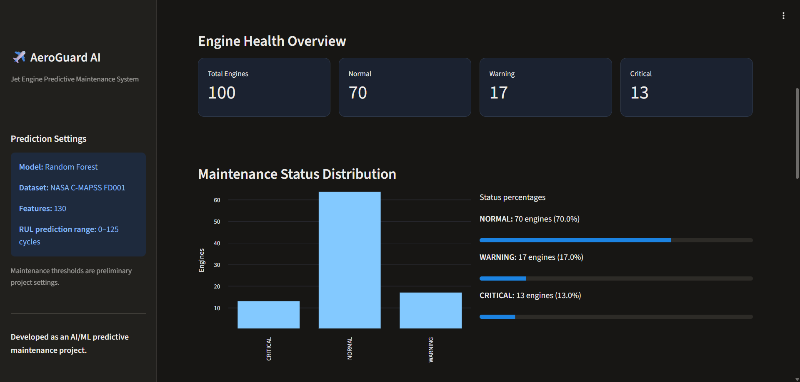

# ✈️ AeroGuard AI
### Intelligent Jet Engine Predictive Maintenance System

<p align="center">
  <b>Predictive Maintenance | Machine Learning | Explainable AI | Docker | Streamlit</b>
</p>

<p align="center">
  <a href="https://aeroguard-ai-ifkf.onrender.com/">🚀 Live Demo</a> •
  <a href="https://github.com/Sunnykakdiya/AeroGuard-AI">📂 GitHub Repository</a> •
  <a href="https://linkedin.com/in/sunny-kakdiya">👨‍💻 LinkedIn</a>
</p>

---

## 🚀 Overview

**AeroGuard AI** is a machine learning-powered predictive maintenance system designed to estimate the Remaining Useful Life (RUL) of aircraft engines using NASA's C-MAPSS FD001 dataset.

The system analyzes historical engine sensor measurements, engineers temporal features, and uses machine learning models to predict how many operational cycles an engine may have remaining before failure.

It includes an interactive Streamlit dashboard for visualizing predictions, monitoring engine health, and identifying engines that may require maintenance attention.

<badge color="success">Live Application</badge>

**Try it here:** https://aeroguard-ai-ifkf.onrender.com/

---

## ✨ Key Features

- **RUL Prediction:** Estimates remaining operational cycles for individual engines.
- **Temporal Feature Engineering:** Generates lag, rolling mean, rolling standard deviation, and difference features.
- **Model Comparison:** Trains and evaluates Random Forest and XGBoost regression models.
- **Engine Health Monitoring:** Categorizes predicted RUL into NORMAL, WARNING, and CRITICAL statuses.
- **Interactive Dashboard:** Visualizes engine health, RUL predictions, and maintenance status.
- **Explainable AI:** Uses SHAP, permutation importance, and feature importance analysis.
- **Production-Oriented Inference:** Includes input validation, feature alignment, and prediction processing.
- **Docker Support:** Containerized application for consistent execution.
- **Cloud Deployment:** Deployed using Render.

---

## 🖥️ Dashboard Preview

<!-- Add your dashboard screenshot at docs/dashboard-preview.png -->

<p align="center">
  
</p>

---

## 🧠 System Architecture

```text
NASA C-MAPSS FD001 Dataset
          |
          ▼
     Data Ingestion
          |
          ▼
   Data Preprocessing
          |
          ▼
   Feature Engineering
          |
          ▼
    Model Training
          |
          ▼
  Model Comparison
  Random Forest / XGBoost
          |
          ▼
    Model Evaluation
          |
          ▼
  Production Inference
          |
          ▼
  Predicted Remaining
      Useful Life
          |
          ▼
   Engine Health Status
          |
          ▼
  Streamlit Dashboard
```

---

## 📊 Dataset

**NASA C-MAPSS — FD001**

The project uses the Commercial Modular Aero-Propulsion System Simulation (C-MAPSS) dataset provided by NASA.

| Dataset component | Description |
|---|---|
| Training data | Engine run-to-failure sensor records |
| Test data | Partial engine operational histories |
| RUL labels | Actual remaining useful life for test engines |
| Sensors | 21 sensor measurements |
| Operating settings | 3 operational settings |
| Test engines | 100 |

The model learns degradation patterns from training data and is evaluated using the official test dataset.

---

## ⚙️ Feature Engineering

The feature engineering pipeline generates temporal features for 15 selected variable sensors.

Features include:

- Lag features: 1 and 3 cycles
- Rolling mean: 5 and 10 cycles
- Rolling standard deviation: 5 and 10 cycles
- First-order difference

**Final feature count: 130**

Engine-wise processing and historical sensor measurements are used to construct temporal features.

---

## 🤖 Machine Learning Models

Two regression models were trained and compared:

1. Random Forest Regressor
2. XGBoost Regressor

**Selected model: Random Forest Regressor**

Random Forest achieved better validation performance across the reported evaluation metrics and was selected as the final model.

### Model Evaluation Comparison — Validation Dataset

| Evaluation Metric | Random Forest | XGBoost |
|---|---:|---:|
| MAE ↓ | **9.7464** | 9.8747 |
| RMSE ↓ | **14.5944** | 14.9158 |
| R² Score ↑ | **0.8776** | 0.8722 |
| NASA Score ↓ | **16,209.98** | 18,426.73 |
| Cross-Validation MAE ↓ | **11.7665** | 11.9749 |

**Metric interpretation:**
- MAE: Average absolute prediction error.
- RMSE: Penalizes larger prediction errors more heavily.
- R²: Measures how much variance is explained by the model.
- NASA Score: Asymmetric scoring function for RUL prediction; lower is better.
- Cross-Validation MAE: Average MAE from the five-fold grouped cross-validation process.

<badge color="success">Best validation model: Random Forest</badge>

Random Forest achieved lower MAE, RMSE, NASA Score, and Cross-Validation MAE, along with a higher R² score.

### Official Test Dataset Evaluation

The selected Random Forest model was also evaluated on the official FD001 test endpoints.

| Metric | Random Forest |
|---|---:|
| MAE | **12.8806** |
| RMSE | **17.7265** |
| R² Score | **0.8043** |
| NASA Score | **582.1609** |

The official test evaluation uses the final observed cycle of each of the 100 test engines.

*Validation and official test metrics are separate evaluations and should not be compared as though they came from the same data split.*

---

## 🔍 Explainable AI (XAI)

AeroGuard AI incorporates explainability techniques to understand which features contribute most to the model's predictions.

Techniques used:

- SHAP (SHapley Additive exPlanations)
- Permutation Feature Importance
- Random Forest Feature Importance

### Top SHAP Features

| Rank | Feature |
|---:|---|
| 1 | cycle |
| 2 | sensor_4_rolling_mean_10 |
| 3 | sensor_4_rolling_mean_5 |
| 4 | sensor_11_rolling_mean_10 |
| 5 | sensor_15_rolling_mean_10 |

These results provide insight into the relationships between engine operating history, sensor behavior, and predicted remaining useful life.

---

## 🚦 Engine Health Classification

The dashboard assigns an illustrative maintenance status based on predicted RUL.

| Predicted RUL | Status |
|---|---|
| Greater than 50 cycles | 🟢 NORMAL |
| 21–50 cycles | 🟡 WARNING |
| 0–20 cycles | 🔴 CRITICAL |

These are preliminary application rules, not validated aircraft maintenance thresholds.

**Safety Disclaimer:** AeroGuard AI is an educational and research project. Its predictions must not be used as the sole basis for real aircraft maintenance or flight-safety decisions.

---

## 🛠️ Technology Stack

| Category | Technologies |
|---|---|
| Programming Language | Python 3.13 |
| Data Processing | NumPy, Pandas |
| Machine Learning | Scikit-learn, XGBoost |
| Explainable AI | SHAP |
| Visualization | Matplotlib, Seaborn |
| Web Application | Streamlit |
| Model Persistence | Joblib |
| Containerization | Docker |
| Version Control | Git, GitHub |
| Cloud Deployment | Render |

---

## 📁 Project Structure

```text
AeroGuard-AI/
│
├── app.py
├── Dockerfile
├── .dockerignore
├── .gitignore
├── requirements.txt
│
├── artifacts/
│   ├── models/
│   │   └── best_model_FD001.pkl
│   │
│   └── preprocessors/
│       ├── feature_columns_FD001.pkl
│       ├── scaler_FD001.pkl
│       └── selected_sensors_FD001.pkl
│
├── configs/
├── notebooks/
│
├── scripts/
│   ├── build_features.py
│   ├── train_models.py
│   └── test_inference.py
│
└── src/
    ├── data/
    │   └── ingestion.py
    │
    ├── features/
    │   └── engineering.py
    │
    └── inference/
        └── predict.py
```

---

## 💻 Installation and Setup

### 1. Clone the repository

```bash
git clone https://github.com/Sunnykakdiya/AeroGuard-AI.git

cd AeroGuard-AI
```

### 2. Create a virtual environment

```bash
python -m venv aeroguard
```

Activate on Windows:

```bash
aeroguard\Scripts\activate
```

### 3. Install dependencies

```bash
pip install -r requirements.txt
```

### 4. Run the Streamlit application

```bash
streamlit run app.py
```

Open:

```text
http://localhost:8501
```

---

## 🐳 Run with Docker

### 1. Build the Docker image

```bash
docker build -t aeroguard-ai:v1 .
```

### 2. Start the container

```bash
docker run -d -p 8501:8501 --name aeroguard-app aeroguard-ai:v1
```

### 3. Open the application

```text
http://localhost:8501
```

### Stop the container

```bash
docker stop aeroguard-app
```

---

## ☁️ Live Deployment

The application is deployed as a Docker-based web service on Render.

<badge color="success">Live</badge>

**Live Application:** https://aeroguard-ai-ifkf.onrender.com/

**GitHub Repository:** https://github.com/Sunnykakdiya/AeroGuard-AI

---

## 🔮 Future Improvements

- LSTM and other deep learning-based RUL prediction models.
- Real-time engine sensor data integration.
- Prediction uncertainty estimation.
- Advanced engine degradation trend analysis.
- Model monitoring and automated retraining.
- Fleet-level predictive maintenance analytics.
- Support for additional NASA C-MAPSS datasets: FD002, FD003, and FD004.

---

## 🎯 Project Objective

The objective of AeroGuard AI is to demonstrate how machine learning, temporal feature engineering, and explainable AI can be combined to develop a predictive maintenance application.

The project covers an end-to-end workflow, from raw sensor data processing and model comparison to official test evaluation, production-oriented inference, dashboard development, Docker containerization, and cloud deployment.

---

## 👨‍💻 Author

### Kakdiya Sunny
**B.Tech Information Technology | AI/ML Enthusiast**

- LinkedIn: [linkedin.com/in/sunny-kakdiya](https://linkedin.com/in/sunny-kakdiya)
- GitHub: [github.com/Sunnykakdiya](https://github.com/Sunnykakdiya)

---

<p align="center">
  <b>Built with Python, Machine Learning, and Explainable AI ✈️</b>
</p>